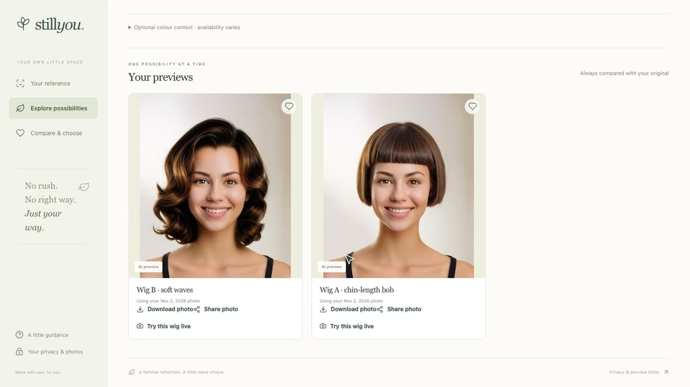

# StillYou

**Choose your wig while you still have your hair.**

StillYou helps someone preparing for chemotherapy pick a wig online. You save a photo of yourself, preview wigs on it with
the YouCam API, compare the options on price, shade and return terms, and keep a written reason for the one you choose.
Family can weigh in through a private link.



## Features

- **Dated reference photo.** Upload or take a photo; it's saved with its date and your permission. Previews always start
  from a saved photo, so you can keep comparing after your hair changes.
- **Wig previews.** Add a photo of a wig and StillYou runs the YouCam AI Hairstyle API in custom-reference mode.
- **Review step.** Each result opens next to the original and the reference. You note what carried through and what
  didn't. A preview has to be reviewed before it can become your pick.
- **Live try-on.** The hair layer from a preview is cut out once and tracked on your face in the browser (MediaPipe).
  Camera frames never leave the device.
- **Brows and hats.** Brow shades via the YouCam Makeup API (skin smoothing off). Hat previews are experimental.
- **Decision board.** Priorities, a budget, and per-wig facts: exact variant link, price, shade, cap size, fibre, and
  return terms with a source. Over-budget prices and open questions are flagged. If a fact or priority changes, the
  current pick is cleared.
- **Before you buy.** A printable card with cap measuring steps, your policy notes and questions for the seller.
- **Family link.** Share selected previews for up to seven days; people vote and leave a note. Revocable. Your original
  photos and private notes are never shared.

No account is needed. Workspaces are tied to a cookie and deleted after 30 days, or immediately from the privacy page.

## YouCam APIs

| API | Endpoint | Used for |
| --- | --- | --- |
| File | `POST /s2s/v2.0/file` + signed PUT | Uploading photos |
| AI Hairstyle VTO | `/s2s/v2.1/task/hair-transfer` | Wig reference on the saved photo, plus template styles |
| AI Makeup VTO | `/s2s/v2.0/task/makeup-vto` | Brow colour |
| AI Hat VTO | `/s2s/v2.0/task/hat` | Hats |
| AI Facial Color Tones | `/s2s/v2.0/task/skin-tone-analysis` | Optional colour context |
| Hair tools | `hair-color`, `hair-bang`, `hair-ext`, `hair-vol`, `hair-curl`, hair detection tasks | The "Cuts, colour & more" tab |

All calls are made server-side (`src/lib/youcam.ts`); the key never reaches the browser. Tasks are created once (no
automatic retries, so failed requests don't burn units) and polled until they finish. Results are copied into our own
storage before YouCam's URLs expire.

## Running locally

Requires Node 22 or 24.

```sh
npm ci
cp .env.example .env.local   # then set YOUCAM_API_KEY
npm run dev
```

Open http://localhost:3000. Locally, data is stored on disk in `.stillyou/`, so no database is needed. Without an API
key everything works except generating new previews.

`npm ci` also downloads the MediaPipe runtime and two models for live mode into `public/live-ar/` (checksummed). If
install scripts are disabled, run `npm run assets:live`.

## Scripts

| Command | |
| --- | --- |
| `npm run test` | Unit tests (Vitest) |
| `npm run lint` / `npm run typecheck` / `npm run build` | |
| `npm run fixtures:download` | Download YouCam's sample hairstyle images for manual testing |
| `npm run gates` | Run real API checks against photos listed in `fixtures/private/gates.json` (uses units) |
| `npm run test:live` | Full browser run with Playwright, creates one real preview (uses units) |
| `npm run test:ar` | Live-mode check with a simulated camera (no API calls) |

## Deploying

One Vercel project. Production needs Neon Postgres and a **private** Vercel Blob store. See
[docs/VERCEL.md](docs/VERCEL.md).

## More

- [Architecture and data lifecycle](docs/ARCHITECTURE.md)
- [Live try-on](docs/LIVE-AR.md)
- [Testing notes and API findings](docs/TESTING.md)

## Limits

A preview shows colour and style. It doesn't show fit, comfort, cap construction or how the fibre feels, and it isn't a
prediction of how you'll look during treatment. Return terms are whatever you enter from the seller's page; StillYou
doesn't verify them. Nothing in the app is medical advice.

## License

[MIT](LICENSE)
